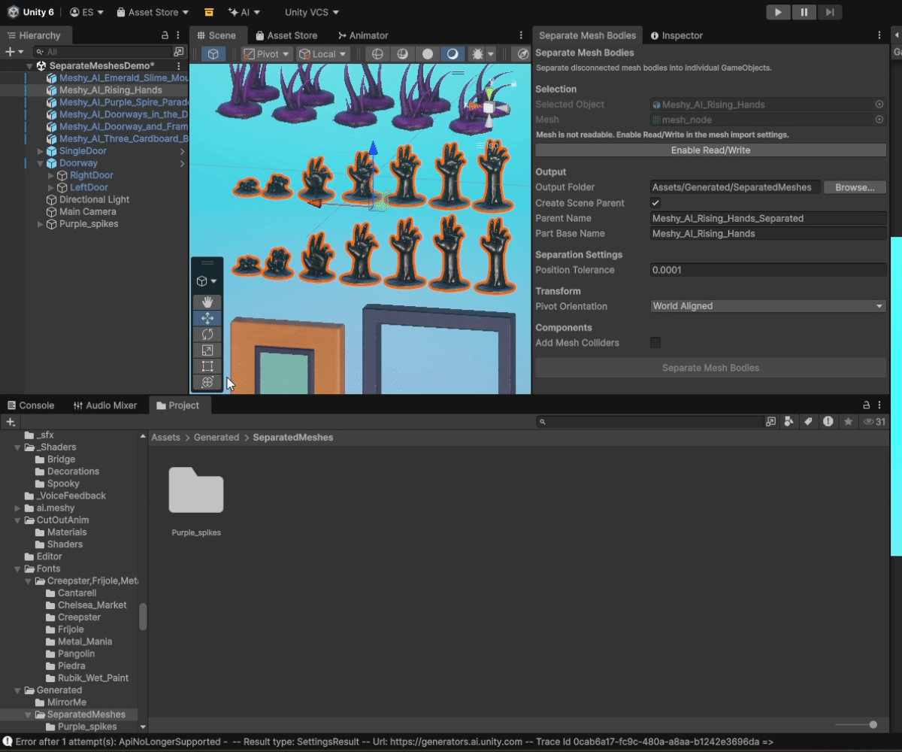
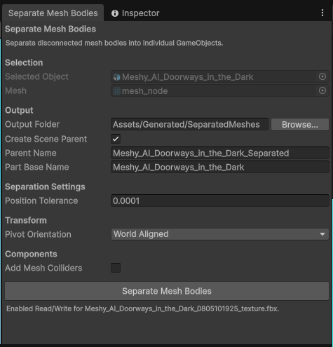

# Separate Mesh Bodies

Separate Mesh Bodies splits disconnected geometry within a single Unity mesh into individual mesh assets and scene GameObjects. It makes imported models easier to work with when several objects arrive combined into one mesh.

It is designed for splitting mesh bodies / geometry islands after import. It is not a general-purpose mesh editor.



## Key Features

- Separates disconnected mesh bodies / geometry islands from a single mesh.
- Uses triangle connectivity plus position-based vertex connectivity.
- Exposes configurable `Position Tolerance` for position-based connectivity.
- Preserves supported mesh data: positions, normals, UV0, UV1, and vertex colors; tangents are supported and may be recalculated when UV0 is available.
- Preserves the source object's material assignments on generated scene objects.
- Creates per-body pivots at each generated body's world-space bounds center.
- Supports pivot orientation modes: `Source Rotation`, `World Aligned`, and `Auto Orient`.
- Can optionally add `MeshCollider` components to generated scene objects.
- Supports a configurable base output folder.
- Creates a unique generated asset subfolder for each successful separation operation.
- Can optionally create a generated scene parent.
- Leaves the source GameObject and source mesh untouched.
- Supports Undo for generated scene objects and generated mesh assets.

## Requirements

The selected mesh must be readable. If the mesh is not readable, the tool disables `Separate Mesh Bodies` and shows a warning.

When the mesh comes from a supported model importer, the Selection section shows an `Enable Read/Write` button. Pressing it explicitly enables `Read/Write` on the model importer, reimports the asset, refreshes validation, and restores the current selection where practical.

If the importer cannot be modified this way, the warning remains and the button is not shown.

## Installation

Copy the Editor script into your Unity project:

```text
Assets/Editor/SeparateMeshBodiesWindow.cs
```

The script must remain inside an `Editor` folder because it uses UnityEditor APIs. No package setup or third-party dependencies are required.

## Usage

1. Select one GameObject that has a direct `MeshFilter`.
2. Open `Tools > Separate Mesh Bodies`.
3. Review the selected object and mesh in the Selection section.
4. Configure output, separation, transform, and component options if needed.
5. Click `Separate Mesh Bodies`.
6. Use the generated scene objects and generated mesh assets.



Children are not processed. `SkinnedMeshRenderer` is not processed.

## Position Tolerance

`Position Tolerance` controls how close separate vertex positions can be while still being treated as connected.

A larger value can connect nearby vertices that use different vertex indices, which is useful for many imported meshes. If the value is too large, nearby but separate mesh bodies may be merged into one detected body.

If no separate bodies are found, try a smaller tolerance. The mesh may also genuinely contain only one connected body.

## Material Behavior — Important

Separated scene objects preserve the source object's material assignments. Generated `.asset` files contain mesh data only; materials belong to the `MeshRenderer`, not the mesh asset.

If you later drag a generated mesh `.asset` directly from the Project window into a scene, Unity will not automatically restore the original material assignment. To retain the existing assignment, use the generated scene objects or manually assign the appropriate material when reusing the mesh asset.

## Output Organization

The base output folder defaults to:

```text
Assets/Generated/SeparatedMeshes
```

Each successful separation operation creates its own subfolder inside the configured base folder.

When `Create Scene Parent` is enabled, the generated asset subfolder uses the effective `Parent Name`.

When `Create Scene Parent` is enabled, the generated parent is positioned at the min/max center of the generated part transform positions. Centering the parent preserves the generated parts' world-space placement.

Example:

```text
Assets/Generated/SeparatedMeshes/Chair_Separated/
  Chair_001.asset
  Chair_002.asset
  Chair_003.asset
```

When `Create Scene Parent` is disabled, the generated asset subfolder uses:

```text
<PartBaseName>_Separated
```

Existing generated folders are not reused. If a folder already exists, Unity-style numeric names are used, such as `Chair_Separated`, `Chair_Separated 1`, and `Chair_Separated 2`.

If separation finds zero or one body, no scene objects, mesh assets, or per-run output folder are created.

## Limitations

- Processes one selected GameObject at a time.
- Requires a direct `MeshFilter` on the selected GameObject.
- Does not traverse children.
- Does not process `SkinnedMeshRenderer`.
- Does not support manual face selection.
- Does not separate by material or submesh alone.
- Generated mesh assets do not store material assignments.
- Mesh data preservation is limited to positions, normals, UV0, UV1, vertex colors, and supported tangent data. Tangents may be recalculated when UV0 is available.
- Does not preserve skinning, bones, bind poses, blend shapes, UV3+, loose vertices, or custom metadata.
- Generated asset Undo cleanup depends on the editor session/domain state. If scripts reload before Undo is used, generated mesh asset cleanup may not be fully recoverable through Undo.

## Compatibility

Tested with Unity `6000.3.15f1`.

## 7 Tools in 7 Days — Day 2

This tool is part of the **7 Tools in 7 Days** series.

[Read the Day 2 development story on Substack](https://ecesefercioglu.substack.com/p/7-tools-in-7-days-day-2-separate)

| Day | Tool |
| --- | --- |
| Day 1 | [Parent From Bounds](https://github.com/seferciogluecce/parent-from-bounds) |
| **Day 2** | **[Separate Mesh Bodies](https://github.com/seferciogluecce/separate-mesh-bodies)** |
| Day 3 | [Brick Wall Generator](https://github.com/seferciogluecce/brick-wall-generator) |
| Day 4 | [Particle System Context Previewer](https://github.com/seferciogluecce/particle-system-context-previewer) |
| Day 5 | [Object Layout Tool](https://github.com/seferciogluecce/object-layout-tool) |
| Day 6 | [DOTween Selection Animation Previewer](https://github.com/seferciogluecce/dotween-selection-animation-previewer) |
| Day 7 | [Wave Object Distributor](https://github.com/seferciogluecce/wave-object-distributor) |

## License

This project is available under the MIT License. See [LICENSE](LICENSE).

